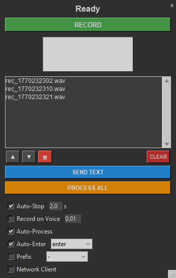

# VoiceInputter

VoiceInputter is a professional Windows tool that turns your voice into text and types it directly into any application. By leveraging local AI power (via ComfyUI/Whisper), it provides high-accuracy transcription with minimal latency and full control over your data.



---

## 🚀 Key Features

### 🎙️ Effortless Control
- **Modern Native Interface:** A responsive PyQt6 window that launches instantly and fits perfectly in your Windows workflow.
- **Configurable Hotkeys:** Set your own global toggle combination (e.g., `CTRL+F9`) or even repetitive sequences (e.g., `F8+F8`).
- **Voice Trigger (VAD):** Automatically start recording when you speak and stop when you're finished.
- **Clean Device List:** Intelligent microphone selection that filters out redundant system entries.

### 🧠 Smart Text Processing
- **Multi-Language Support:** Choose specific languages or let the AI auto-detect. Options are dynamically synced with your AI engine.
- **Smart Spacing:** Automatically handles spaces between successive transcriptions for a natural flow.
- **Dynamic Formatting:** Supports auto-numbering, bullet points, and custom prefixes/postfixes.
- **Auto-Enter Modes:** Choose how text is submitted (Enter, Shift+Enter, etc.) to match any application.

### 🌐 Advanced Connectivity
- **Telegram & Matrix Bots:** Turn your machine into a remote transcription server. Send voice messages to your bot from any device, and it will transcribe them locally and reply with text.
- **LAN Network Mode:** Offload heavy AI processing to another powerful PC on your local network.

---

## 🛠️ User Setup

### 1. Requirements
- **Windows 10/11**
- Choose either **ComfyUI** on port `8188` with the included `stt.json` workflow, or **Whisper (local)** in the General tab.
- Local Whisper uses the `base` model on the CPU. The model is downloaded on first use, so that first transcription requires an internet connection and can take longer.

### 2. Getting Started
1.  Download the latest `voice_inputter.exe`.
2.  Select the transcription backend in the **General** tab. If using ComfyUI, ensure it is running.
3.  Launch the app and configure your preferred hotkey in the **Hotkeys** tab.
4.  Select your target application and start speaking!

### 3. Configuration
For automated login to Matrix, Telegram, or Network modes, you can create a `secrets.json` file:
```json
{
    "telegram_token": "your_bot_token",
    "matrix_homeserver": "https://matrix.org",
    "matrix_user": "@your_user:matrix.org",
    "matrix_token": "your_access_token"
}
```

---

## 👨‍💻 Developer Section

### Prerequisites
- Python 3.10+
- `pip install -r requirements.txt`

### Building from Source
We use PyInstaller to create the standalone executable:
```bash
pyinstaller --onefile --windowed --add-data "stt.json;." voice_inputter.py
```

### Project Structure
- `src/gui.py`: Responsive PyQt6 interface with modal hotkey capturing.
- `src/comfy.py`: API client with dynamic language discovery and injection.
- `src/whisper_backend.py`: Local faster-whisper transcription backend.
- `src/telegram_client.py` & `src/matrix_client.py`: Remote protocol integrations.
- `src/audio.py`: Low-latency capture with VAD and device de-duplication.
- `voice_inputter.py`: Multi-threaded coordinator and sequence detection logic.
